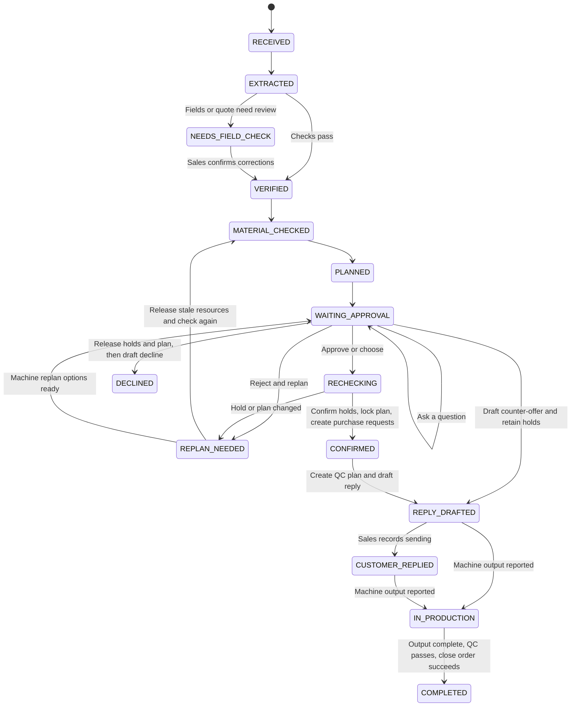

# Factory orchestrator and shop-floor services

`python -m app.orchestrator` consumes order and machine events and agent results. It processes due work, escalates pending approvals, and dispatches live events. The Quality, Monitoring, and Maintenance workers run through their `python -m app.agents.<agent>` entry points. FastAPI discovers the REST routers automatically.

## Workflow recovery and decisions

- A row lock on the order serializes decisions, result application, retries, and state changes for that order. The workflow persists the next action and attempt metadata before dispatch. On restart it recovers a logged task ID when necessary and retains the task deadline. Results must match the current attempt and the task they reply to.
- An unanswered or failed task is retried up to `TASK_MAX_ATTEMPTS`, then the workflow records `FAILED` and notifies managers and administrators. Agent actions must be idempotent because a timeout can occur after an agent has already performed its work. The audit log retains state changes and decisions. Live events are staged in the same transaction and delivered at least once.
- Each active approval accepts one decision. Questions leave the approval open. The manager's configured backup can decide once escalation has been sent. Rechecking collects changes from both Material and Planning. A follow-up pack displays those changes. A revised order waits for the previous order's release tasks. A machine outage requests new options for the orders Planning reports as affected.
- Dates used for approval reminders and escalation come from the effective business settings. QC starts with a first-piece inspection for each line, then creates checks at the part's sampling interval. The latest record for each check must pass. After all locked slots have a full output count or are marked done, a missing or failed QC check keeps the order open.

## API and reporting

- Chat uses seven read-only tools. What-if uses the contracted P2 REST endpoint in process. The service retains the latest 20 chat messages per user in memory and logs Claude usage through P1's client. Tool progress arrives as plain text before the final answer. The Claude call returns a complete answer, which is sent in chunks.
- WebSockets use `/ws?token=…` and emit a heartbeat every 20 seconds. Each connection subscribes separately. Store users get message metadata without payloads, free-text notes, or cost. A notification goes only to listed users. On reconnect, the live feed resumes with current events. Clients can retrieve missed state and activity from REST.
- Monitoring treats machine counts as cumulative for the current slot. It estimates delay from elapsed time and the fraction of planned quantity produced. A delay alert fires when the delay exceeds 30 minutes. Maintenance publishes a new event when a recorded window changes.
- Dashboard date windows follow `APP_TIMEZONE`. On-time delivery compares local completion day with the promised date, or the due date when no promise exists. PO-to-approval uses positive decisions on order approvals. Extraction accuracy reports the share of fields without a human correction. Utilisation divides recorded running time by elapsed calendar time in the selected period. Planned runtime uses the overlapping durations of locked and done slots. AI cost per order averages costs across orders with logged calls. Queue depth and dead letters come from RabbitMQ management when reachable.

## Verification

Run `python -m pytest tests/orchestrator` from `backend` with P1's PostgreSQL fixtures. The suite covers successful approval and drafting, field corrections, all rejection routes, rechecks, revisions, retries, restart recovery, reminders and escalation, duplicate results, machine replans, chat tool permissions, live event filtering, KPI calculations, QC gating, machine events, and delay detection. P2 results and Claude calls are faked. See [P3 integration requests](requests/p3.md) for shared dependencies and handoff details.
